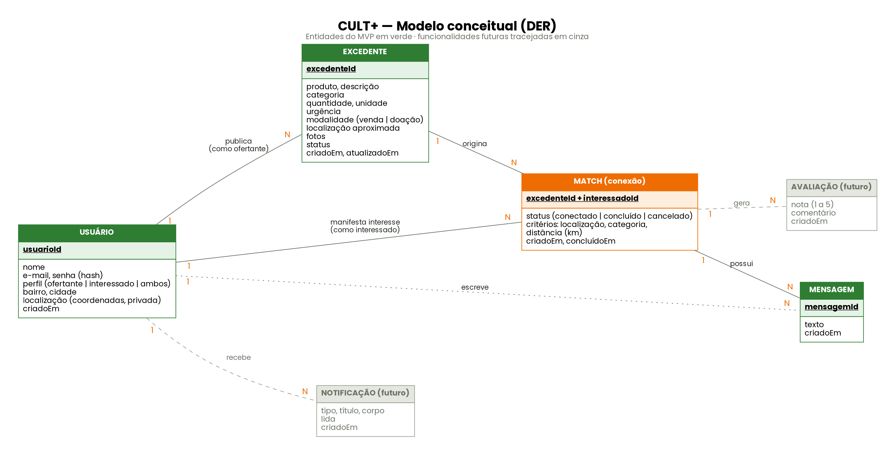

# 2. Modelo conceitual (DER)

O código-fonte do diagrama está em `diagramas/der-conceitual.dot` (Graphviz: `dot -Tpng -Gdpi=170 der-conceitual.dot -o der-conceitual.png`). O modelo conceitual é independente do banco; a tradução para o MongoDB está no documento 03.

## 2.1 Entidades

| Entidade | Descrição | Fase |
|---|---|---|
| Usuário | Pessoa que usa o CULT+ como ofertante, interessado ou ambos. | MVP |
| Excedente | Oferta de produto cultivado em casa, para venda ou doação. | MVP |
| Match (conexão) | Ligação entre um excedente e um interessado. Também é a conversa do chat. | MVP |
| Mensagem | Texto trocado entre ofertante e interessado dentro de um match. | MVP |
| Avaliação | Nota e comentário entre as partes após a negociação. | Futuro |
| Notificação | Alerta ao usuário (novo excedente compatível, match, mensagem). | Futuro |

## 2.2 Relacionamentos e cardinalidades

| Relacionamento | Cardinalidade | Regra |
|---|---|---|
| Usuário **publica** Excedente | 1 : N | Um usuário com perfil ofertante ou ambos publica várias ofertas; cada oferta tem um único ofertante. |
| Usuário **manifesta interesse** em Excedente (gera Match) | 1 : N | Um usuário com perfil interessado ou ambos pode ter vários matches. |
| Excedente **origina** Match | 1 : N | Uma oferta pode ter vários interessados; cada match refere-se a uma única oferta. |
| Usuário + Excedente → Match | N : N resolvido | O par (oferta, interessado) é único. |
| Match **possui** Mensagem | 1 : N | Cada match tem uma única conversa, com várias mensagens. |
| Usuário **escreve** Mensagem | 1 : N | O autor precisa ser ofertante ou interessado do match. |
| Match **gera** Avaliação | 1 : N | Futuro: até duas avaliações por match, uma de cada parte. |
| Usuário **recebe** Notificação | 1 : N | Futuro. |

## 2.3 Regras de negócio refletidas no modelo

1. Ofertante e interessado de um mesmo match são usuários diferentes.
2. Só ofertas com `status = "disponivel"` entram na busca e podem receber novos matches.
3. Um match concluído marca a oferta correspondente como concluída.
4. Ofertas e usuários não são apagados: a retirada de uma oferta usa `status = "removido"`.
5. O match registra os critérios que o justificaram (`criterios`), para permitir avaliar se localização e categoria são suficientes.
6. O e-mail de cada usuário é único, e o par (oferta, interessado) só pode gerar um match.
