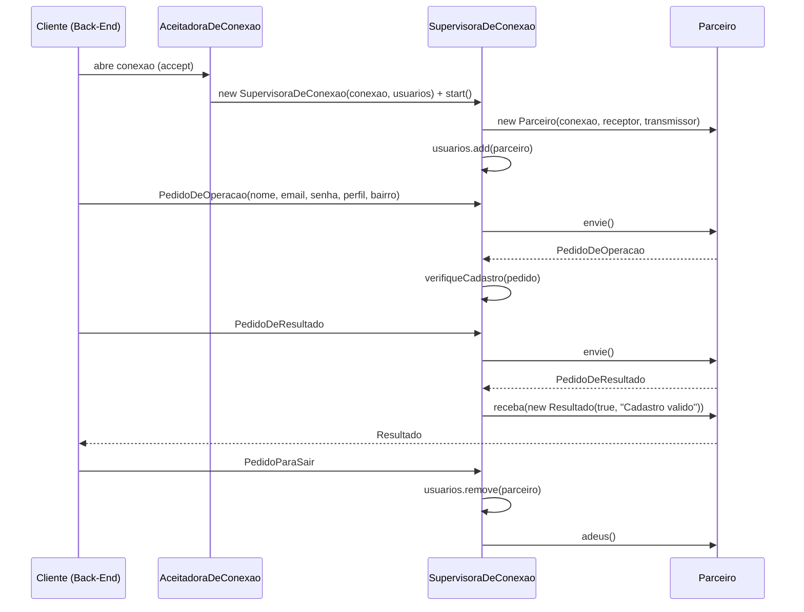

<!-- Autor: Henrique Leite de Camargo RA: 25005997 -->
# Testes interclasse do servidor Java (item F) — CULT+ / Time 28

## 1. Serviço escolhido

**Verificação de cadastro.** É a funcionalidade central do servidor Java (`Servidor/auth`): o Back-End (Node) envia os dados do cadastro (nome, e-mail, senha, perfil, bairro) e o servidor responde se são válidos e, se não forem, o motivo. O cadastro só segue para o MongoDB se o servidor responder "válido".

Regras aplicadas em `SupervisoraDeConexao.verifiqueCadastro`, nesta ordem, parando no primeiro erro: nome de 1 a 60 caracteres; e-mail no formato `x@y.z`; senha de 8 a 72 caracteres; perfil `ofertante`, `interessado` ou `ambos`; bairro não vazio.

## 2. Classes participantes

| Classe | Papel no serviço |
|---|---|
| `Servidor` | `main`: cria a lista de usuários e inicia a `AceitadoraDeConexao` (porta 3000) |
| `AceitadoraDeConexao` | espera conexões (`accept`) e cria uma `SupervisoraDeConexao` por cliente |
| `SupervisoraDeConexao` | thread de cada conexão: lê os comunicados, valida (`verifiqueCadastro`) e responde |
| `Parceiro` | encapsula socket e streams: `envie` (lê), `receba` (escreve), `adeus` (fecha) |
| `PedidoDeOperacao` | comunicado com os 5 dados do cadastro |
| `PedidoDeResultado` | comunicado que pede o resultado da última verificação |
| `Resultado` | resposta com `valido` e `mensagem` |
| `PedidoParaSair` | comunicado que encerra a conexão |
| `Comunicado` | superclasse serializável de todos os comunicados |

## 3. Sequência de chamadas — cenário NORMAL (cadastro válido)

1. `Servidor.main` cria `ArrayList<Parceiro> usuarios` e chama `new AceitadoraDeConexao(porta, usuarios)` e `start()`.
2. O cliente (Back-End) abre a conexão; `AceitadoraDeConexao.run` retorna de `ServerSocket.accept()`.
3. `AceitadoraDeConexao.run` chama `new SupervisoraDeConexao(conexao, usuarios)` e `start()`.
4. `SupervisoraDeConexao.run` cria `ObjectOutputStream` e `ObjectInputStream` sobre o socket.
5. `SupervisoraDeConexao.run` chama `new Parceiro(conexao, receptor, transmissor)`.
6. `SupervisoraDeConexao.run` faz `usuarios.add(parceiro)` (dentro de `synchronized`).
7. O cliente envia `new PedidoDeOperacao(nome, email, senha, perfil, bairro)`.
8. `SupervisoraDeConexao.run` chama `Parceiro.envie()`, que lê o objeto e devolve o `PedidoDeOperacao`.
9. `SupervisoraDeConexao.run` chama `verifiqueCadastro(pedido)`, que usa `getNome`, `getEmail`, `getSenha`, `getPerfil`, `getBairro` e passa pelas 5 regras; no fim define `valido = true` e `mensagem = "Cadastro valido"`.
10. O cliente envia `new PedidoDeResultado()`.
11. `SupervisoraDeConexao.run` chama `Parceiro.envie()` e recebe o `PedidoDeResultado`.
12. `SupervisoraDeConexao.run` chama `Parceiro.receba(new Resultado(valido, mensagem))`, que faz `writeObject` e `flush`.
13. O cliente lê o `Resultado` (`isValido() == true`, `getMensagem() == "Cadastro valido"`).
14. O cliente envia `new PedidoParaSair()`; `SupervisoraDeConexao.run` faz `usuarios.remove(parceiro)` e chama `Parceiro.adeus()`, que fecha streams e socket.



## 4. Cenários de teste

| Código | Cenário | Entrada | Resultado esperado |
|---|---|---|---|
| CT-F01 | Normal | `Maria da Silva`, `maria@email.com`, `senha1234`, `ofertante`, `Centro` | `Resultado(valido=true, "Cadastro valido")`; lista de usuários com 1 `Parceiro` durante a conexão e vazia depois de `PedidoParaSair`; conexão fechada pelo servidor |
| CT-F02 | Alternativo | mesmos dados, com e-mail `maria-sem-arroba` | `Resultado(valido=false, "E-mail invalido")`; o `Parceiro` continua na lista; um novo cadastro válido na mesma conexão é aceito |
| CT-F03 | Complementar | construtores com parâmetros nulos ou inválidos | exceções `Conexao ausente`, `Usuarios ausentes`, `Porta invalida`, `Receptor ausente` |

**Sequência do CT-F02:** passos 1 a 8 iguais ao cenário normal; no passo 9, `verifiqueCadastro` para na regra do e-mail (`valido = false`, `mensagem = "E-mail invalido"`); os passos 10 a 13 devolvem esse `Resultado` ao cliente; a conexão permanece aberta.

## 5. Código completo dos testes

Arquivo `Servidor/auth/Teste/ServicoCadastroInterclasseTest.java` (JUnit 4.13.2, sem Mockito: as classes reais conversam por socket local, então não há dependência externa a simular):

```java
//Autor: Henrique Leite de Camargo RA: 25005997
//testes INTERCLASSE do servico principal: verificacao de cadastro (Servidor/auth)
//classes participantes: AceitadoraDeConexao, SupervisoraDeConexao, Parceiro, PedidoDeOperacao, PedidoDeResultado, PedidoParaSair, Resultado
package auth;

import static org.junit.Assert.*;

import java.io.*;
import java.net.*;
import java.util.*;

import org.junit.*;

public class ServicoCadastroInterclasseTest
{
    private ArrayList<Parceiro> usuarios;
    private int porta;

    private Socket conexao;
    private ObjectOutputStream saida;
    private ObjectInputStream entrada;

    //sobe o servidor de verdade numa porta livre, com a lista de usuarios na mao para observar o que as classes fazem com ela
    @Before
    public void sobeServidorEConecta () throws Exception
    {
        ServerSocket livre = new ServerSocket (0);
        this.porta = livre.getLocalPort();
        livre.close();

        this.usuarios = new ArrayList<Parceiro>();
        AceitadoraDeConexao aceitadora = new AceitadoraDeConexao (String.valueOf(this.porta), this.usuarios);
        aceitadora.setDaemon (true);
        aceitadora.start();

        this.conexao = new Socket ("localhost", this.porta);
        this.saida   = new ObjectOutputStream (this.conexao.getOutputStream());
        this.entrada = new ObjectInputStream  (this.conexao.getInputStream());
    }

    @After
    public void fechaConexao () throws Exception
    {
        this.conexao.close();
    }

    //espera a supervisora (que roda em outra thread) chegar ao tamanho esperado da lista
    private boolean esperaUsuarios (int esperado) throws Exception
    {
        for (int i = 0; i < 40; i++)
        {
            synchronized (this.usuarios)
            {
                if (this.usuarios.size() == esperado)
                    return true;
            }
            Thread.sleep (50);
        }
        return false;
    }

    private Resultado verifica (String nome, String email, String senha, String perfil, String bairro) throws Exception
    {
        this.saida.writeObject (new PedidoDeOperacao (nome, email, senha, perfil, bairro));
        this.saida.writeObject (new PedidoDeResultado());
        this.saida.flush();
        return (Resultado) this.entrada.readObject();
    }

    //CT-F01: cenario normal - cadastro valido percorre Aceitadora -> Supervisora -> Parceiro -> verifiqueCadastro -> Resultado
    @Test
    public void cenarioNormal_cadastroValidoPercorreTodasAsClasses () throws Exception
    {
        assertTrue ("Aceitadora e Supervisora deveriam registrar 1 Parceiro na lista", this.esperaUsuarios (1));

        Resultado resultado = this.verifica ("Maria da Silva", "maria@email.com", "senha1234", "ofertante", "Centro");

        assertTrue (resultado.isValido());
        assertEquals ("Cadastro valido", resultado.getMensagem());
        assertEquals ("valido: Cadastro valido", resultado.toString());

        this.saida.writeObject (new PedidoParaSair());
        this.saida.flush();

        assertTrue ("Supervisora deveria remover o Parceiro da lista ao sair", this.esperaUsuarios (0));
        try
        {
            this.entrada.readObject();
            fail ("Parceiro.adeus deveria ter fechado a conexao");
        }
        catch (IOException esperado)
        {
        }
    }

    //CT-F02: cenario alternativo - e-mail invalido e recusado, a conexao continua viva e aceita novo cadastro
    @Test
    public void cenarioAlternativo_emailInvalidoERecusadoEConexaoContinua () throws Exception
    {
        assertTrue (this.esperaUsuarios (1));

        Resultado recusado = this.verifica ("Maria da Silva", "maria-sem-arroba", "senha1234", "ofertante", "Centro");

        assertFalse (recusado.isValido());
        assertEquals ("E-mail invalido", recusado.getMensagem());
        assertEquals ("invalido: E-mail invalido", recusado.toString());
        assertTrue ("Recusar o cadastro nao pode remover o Parceiro da lista", this.esperaUsuarios (1));

        Resultado aceito = this.verifica ("Maria da Silva", "maria@email.com", "senha1234", "ofertante", "Centro");

        assertTrue (aceito.isValido());
        assertEquals ("Cadastro valido", aceito.getMensagem());
    }

    //CT-F03 (complementar): chamadas com parametros ausentes lancam excecao nas classes do servico
    @Test
    public void complementar_parametrosAusentesLancamExcecao () throws Exception
    {
        try
        {
            new SupervisoraDeConexao (null, new ArrayList<Parceiro>());
            fail ("deveria lancar excecao");
        }
        catch (Exception erro)
        {
            assertEquals ("Conexao ausente", erro.getMessage());
        }

        try
        {
            new SupervisoraDeConexao (this.conexao, null);
            fail ("deveria lancar excecao");
        }
        catch (Exception erro)
        {
            assertEquals ("Usuarios ausentes", erro.getMessage());
        }

        try
        {
            new AceitadoraDeConexao ("abc", new ArrayList<Parceiro>());
            fail ("deveria lancar excecao");
        }
        catch (Exception erro)
        {
            assertEquals ("Porta invalida", erro.getMessage());
        }

        try
        {
            new Parceiro (this.conexao, null, null);
            fail ("deveria lancar excecao");
        }
        catch (Exception erro)
        {
            assertEquals ("Receptor ausente", erro.getMessage());
        }
    }
}
```

## 6. Execução

Compilação e execução (a partir de `Servidor/auth`, com JDK 21):

```
javac -d out\servidor Servidor\*.java
javac -cp "out\servidor;lib\*" -d out\teste Teste\*.java
java -cp "out\servidor;out\teste;lib\*" org.junit.runner.JUnitCore auth.ServicoCadastroInterclasseTest
```

Resultado real: `OK (3 tests)`, tempo de 0,396 s (JUnit 4.13.2, OpenJDK 21.0.13).

## 7. Falhas, anomalias e melhorias

| # | Local | Descrição | Causa provável | Como foi verificado | Melhoria sugerida |
|---|---|---|---|---|---|
| 1 | `SupervisoraDeConexao.run` (bloco `catch` final) | Se o cliente cai sem enviar `PedidoParaSair`, o `Parceiro` **não é removido** da lista `usuarios` e fica lá para sempre | a remoção só acontece no ramo `PedidoParaSair`; o `catch` apenas fecha os streams | **Executado**: após fechar o socket de um cliente sem `PedidoParaSair`, a lista continuou com 1 usuário (e continuou com 1 depois de outro cliente sair normalmente) | remover o parceiro da lista também no `catch`/`finally` |
| 2 | `Parceiro.espie` | O semáforo `mutEx` não é liberado se `readObject` lança exceção; uma chamada seguinte ficaria bloqueada em `acquireUninterruptibly` | `release()` fora de `finally` | Inspeção do código (o caminho não é usado pelo servidor, só pelo cliente) | colocar `release()` em `finally` |
| 3 | `SupervisoraDeConexao.run` (ramo `PedidoParaSair`) | Depois de `adeus()` o laço não termina: volta a `envie()` e só acaba pela exceção "Erro de recepcao" | falta um `return` | Inspeção do código | `return` após `adeus()` |
| 4 | `Servidor.main` | Se `Teclado.getUmString()` falhar (entrada fechada), `comando` fica `null` e `comando.toLowerCase()` lança `NullPointerException` | `catch` vazio e `null` não tratado | Inspeção do código | tratar `comando == null` |
| 5 | `AceitadoraDeConexao.run` | O `continue` em caso de erro no `accept` repete sem pausa, e `supervisoraDeConexao.start()` assume que o construtor nunca falha | `catch` vazio, comentário afirma que os parâmetros estão corretos | Inspeção do código | pausa curta no erro e checagem de `null` |
| 6 | `Comunicado` (Servidor e Cliente) | Não há `serialVersionUID`; as classes existem duplicadas nos dois lados e qualquer mudança em uma delas quebra a desserialização sem aviso claro | duplicação de classes do molde | Inspeção do código | declarar `serialVersionUID` nas duas cópias |
| 7 | `Back-End/api/src/shared/servidorVerificacao.ts` | Cada cadastro abre uma JVM nova e depende do texto `Resultado atual:` impresso no console do cliente; usa `java` do PATH e a pasta `Cliente/bin`, que não está no Git | integração feita por entrada/saída padrão do cliente interativo | Inspeção do código | cliente Java não interativo (ou socket direto) e documentar a compilação de `Cliente/bin` |

Fora do escopo: os testes não cobrem o `servidorVerificacao.ts` nem o `Cliente` interativo (já listados como limitação no `docs/relatorio-de-testes.md`).
